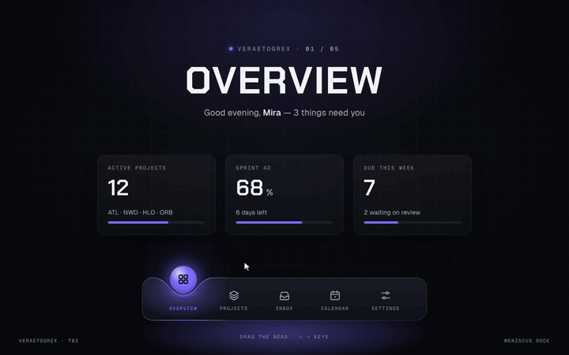

# Meniscus Dock

**The tab doesn't slide. The dock melts around it.**



**Live demo:** [veraetogrex-portfolio.github.io/meniscus-dock](https://veraetogrex-portfolio.github.io/meniscus-dock/) · **Mockup:** [full-screen version](https://veraetogrex-portfolio.github.io/meniscus-dock/mockup/meniscus-dock.html)

One SVG path is rebuilt every frame. Its dip chases the glowing bead on a spring, and the colour blends in HSL from one section to the next, never passing through green.

## Use it

Three files, no build step, no dependencies, no web fonts:

```
index.html   markup
style.css    styles and keyframes
script.js    behaviour
```

Download the repo and open `index.html`, or copy the three files into your project.

## Try it

- Click any section.
- Drag the bead along the dock: the colour and the title change on the way.
- `←` `→` keys.

## Make it yours

Sections, labels and colours are the `SECTIONS` array at the top of `script.js`. Colours are CSS custom properties at the top of `style.css`.

`prefers-reduced-motion` is respected: heavy motion drops to short fades.

## What's in `mockup/`

The full 1440×900 screen this component was shot in for the reel:

- `mockup/meniscus-dock.html` — interactive. `D` plays the demo, `R` resets.
- `mockup/meniscus-dock.autoplay.html` — the scripted ~6 s loop with a drawn cursor.
- URL flags: `?frame` puts the screen in a browser window, `?clean` hides the control panel, `?once` plays the demo once.

The mockup uses a shared stage runtime and bundled fonts from `mockup/_shared/`. The component in the root doesn't need any of it.

---

Component 03 of a series. New one every day on Instagram [@veraetogrex_portfolio](https://www.instagram.com/veraetogrex_portfolio/) · all components: [github.com/veraetogrex-portfolio](https://github.com/veraetogrex-portfolio)

MIT licensed.
